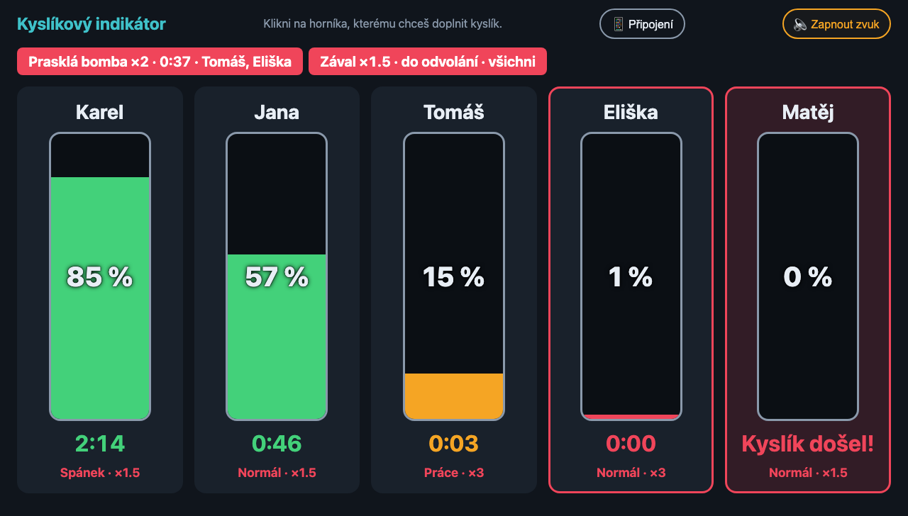
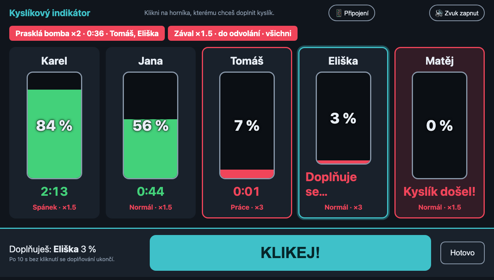
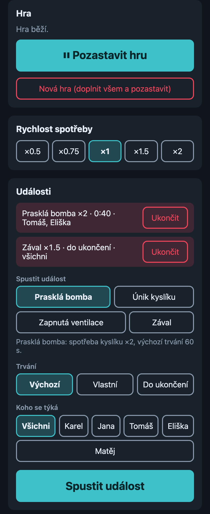
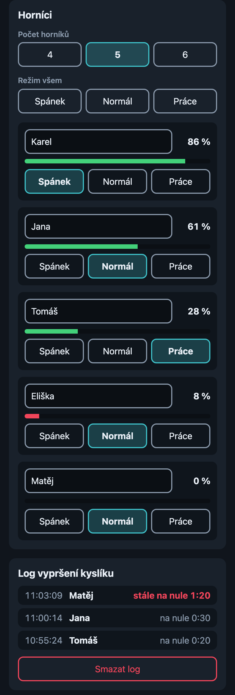

# Kyslíkový indikátor

Herní displej a administrace pro hornickou hru na víkendovce (děti z 8.–9. třídy ZŠ). Na počítači běží server a velký displej ukazuje, kolik kyslíku zbývá horníkům. Když kyslík dochází, počítač houká. Operátor musí k počítači přiběhnout a horníkovi kyslík **doplnit klikáním myší**. Hru řídí vedoucí z mobilu: spouští události (prasklá bomba), mění rychlost spotřeby a vidí, komu kdy kyslík došel.

Aplikace běží na jakémkoli systému s Node.js, nepotřebuje internet a nemá žádné závislosti k instalaci.



## Co umí

- **Displej** se 4 až 6 ukazateli kyslíku (barevné pásma, zbývající čas, režim spotřeby, běžící události s odpočtem).
- **Zvukový alarm:** pod 25 % pípá a čím méně kyslíku, tím rychleji. Po vyčerpání houká siréna. Výška tónu prozradí, kterému horníkovi kyslík dochází.
- **Doplňování klikáním:** doplňovat může vždy jen jeden operátor a jen z počítače se serverem.
- **Administrace v mobilu** chráněná PINem: start a pauza, rychlost, počet horníků, jména, režim spotřeby každého horníka (spánek / normál / práce), speciální události, log vypršení kyslíku.
- **Upozornění na mobilu**, když někomu kyslík dojde (banner, pípání, vibrace).
- **Log vypršení** s časem a s dobou, po kterou byl horník bez kyslíku (podklad pro postihy ve hře).
- **Záloha hry:** po vypnutí nebo pádu serveru se hra obnoví tam, kde skončila (pozastavená).

## Rychlý start

Potřebujete [Node.js](https://nodejs.org/) 20 nebo novější (`node --version`).

```
git clone https://github.com/Salesiani-Pardubice/oxygen-indicator.git
cd oxygen-indicator
npm start
```

Server vypíše adresy a **PIN do administrace**:

```
Kyslíkový indikátor běží.
  Displej:  http://localhost:3000/
  Admin:    http://localhost:3000/admin   PIN: 4821
  V síti:   http://192.168.0.153:3000/  (admin: /admin)
```

Displej otevřete v prohlížeči na počítači, nejlépe na celou obrazovku (F11). Hra po startu serveru **čeká pozastavená**, dokud ji vedoucí nespustí v administraci.

## Příprava před hrou

1. **Stáhněte projekt předem** (stačí složka, žádný `npm install`). Za hry už internet potřeba není.
2. **Vytvořte Wi-Fi hotspot** na počítači se serverem (Windows: *Mobilní hotspot*, macOS: *Sdílení internetu*, nebo prostě společná Wi-Fi). Mobil vedoucího se k němu připojí. Internet přes hotspot není nutný.
3. **Spusťte server** (`npm start`). Pokud systém zobrazí upozornění firewallu, povolte Node.js příchozí spojení v soukromé síti, jinak se mobil nepřipojí.
4. **Připojte mobil.** Na displeji klikněte na **Připojení**: zobrazí se QR kód a adresa administrace. Naskenujte kód mobilem a zadejte PIN z okna serveru.
5. **Zvuk:** na displeji klikněte na **Zapnout zvuk** (prohlížeče povolí zvuk až po kliknutí). Uslyšíte krátké pípnutí. Na mobilu stejně zapněte **Upozornění**.
6. V administraci nastavte **počet horníků** a **jména**.

Jednou za čas doporučujeme krátký zkušební běh: v administraci v *Nastavení* nastavte masku *Normál* na 10 s, spusťte hru a zkontrolujte alarm, upozornění a log. Potom hodnotu vraťte (120 s) a dejte **Nová hra**.

## Jak se hra hraje

### Operátor u počítače



1. Operátor přiběhne k počítači a **klikne na ukazatel svého horníka**.
2. Dole se objeví velké tlačítko **KLIKEJ!**. Každé kliknutí přidá kus kyslíku (výchozí +1 %), takže plná maska znamená opravdu hodně klikání.
3. Doplňování končí samo, když je maska plná, po 10 s bez kliknutí, nebo tlačítkem **Hotovo**. Plné doplnění není nutné.
4. Zatímco jeden operátor doplňuje, ostatní to zkusit nemohou (uvidí „Právě doplňuje kyslík někdo jiný“).

Barvy ukazatelů: zelená (nad 25 %), oranžová (10–25 %), červená (pod 10 %), blikající červená = kyslík došel. Pod ukazatelem je zbývající čas a režim spotřeby (např. `Práce · ×3` = režim práce a násobič událostí).

### Vedoucí s mobilem

Otevřete `/admin` a zadejte PIN.



- **Hra:** *Spustit/Pozastavit hru*. **Nová hra** doplní všem kyslík, ukončí události a hru pozastaví (jména, režimy a log zůstanou).
- **Rychlost spotřeby:** globální násobič ×0,5 až ×2 (na displeji se ukáže štítek s rychlostí).
- **Události:** vyberte událost (prasklá bomba, únik kyslíku, ventilace, zával), **trvání** (výchozí / vlastní / do ručního ukončení) a **koho se týká** (všichni, nebo vybraní horníci), pak **Spustit událost**. Běžící události se dají kdykoli ukončit. Při pauze se odpočet zastaví a násobiče se sčítají (×2 a ×1,5 = ×3).



- **Horníci:** počet (4–6), jméno a **režim spotřeby každého horníka zvlášť** (spánek 4 min, normál 2 min, práce 1 min na plnou masku) nebo najednou všem.
- **Log vypršení kyslíku:** kdy a komu kyslík došel, a jak dlouho zůstal na nule (*stále na nule 1:20* = ještě nedoplněno). Když kyslík někomu dojde, mobil zapípá a zavibruje (vibrace na iPhonu nefungují). **Nechte mobil odemčený** a stránku otevřenou, jinak telefon upozornění nepřijme.
- **Nastavení** (rozbalovací): délka masky v jednotlivých režimech a kolik kyslíku přidá jedno kliknutí.

## Nastavení

Proměnné prostředí (nepovinné):

| Proměnná | Výchozí | Význam |
|---|---|---|
| `PORT` | `3000` | port serveru |
| `ADMIN_PIN` | náhodný při každém startu | pevný PIN do administrace (`ADMIN_PIN=1234 npm start`) |
| `STATE_FILE` | `data/state.json` | kam se ukládá rozehraná hra |
| `ALLOW_REMOTE_REFILL` | vypnuto | `1` dovolí doplňovat i z jiných zařízení (jen pro zkoušení) |

Speciální události se definují v [`config/events.json`](config/events.json): `id`, `label` (název), `multiplier` (násobič spotřeby) a `durationSec` (výchozí trvání v sekundách, `null` = do ručního ukončení). Po úpravě restartujte server. Chybný soubor server při startu odmítne s popisem chyby.

## Časté potíže

- **Mobil se nepřipojí:** je ve stejné síti jako počítač? Použijte adresu z okna serveru (ne `localhost`). Zkontrolujte firewall.
- **Neslyším alarm:** na displeji klikněte na *Zapnout zvuk* a zkontrolujte, že není *Zvuk ztlumen*. Zvuk se zapne až po kliknutí na stránku.
- **Zapomenutý PIN:** je vypsaný v okně serveru. Pro pevný PIN použijte `ADMIN_PIN`.
- **Doplňování z mobilu nejde:** je to záměr, doplňovat lze jen z počítače se serverem.
- **Po restartu hra stojí:** záměr, obnovená hra je pozastavená, spusťte ji v administraci. Úplně nová hra: **Nová hra**, případně při vypnutém serveru smažte `data/state.json`.
- **Po pádu je v `data/` soubor `state.json.broken`:** uložený stav se nepodařilo načíst, hra začala znovu a poškozený soubor zůstal k nahlédnutí.

## Pro vývojáře

```
npm test               # všechny testy (node:test)
npm run screenshots    # znovu vygeneruje obrázky v docs/screenshots (Node 22+ a Chrome)
```

Server je čistý Node.js bez závislostí, klient čisté HTML/CSS/JS bez build kroku. Hra se počítá na serveru (`server/game.js`), displej i administrace jen zobrazují stav přijatý přes SSE. Podrobný popis architektury je v [AGENTS.md](AGENTS.md), pravidla pro přispívání v [CONTRIBUTING.md](CONTRIBUTING.md). Původní zadání je v [docs/puvodni-zadani.md](docs/puvodni-zadani.md).

Součástí repozitáře je knihovna [qrcode-generator](https://github.com/kazuhikoarase/qrcode-generator) (MIT, beze změn, viz `public/vendor/NOTICE.txt`) pro QR kód k administraci.
